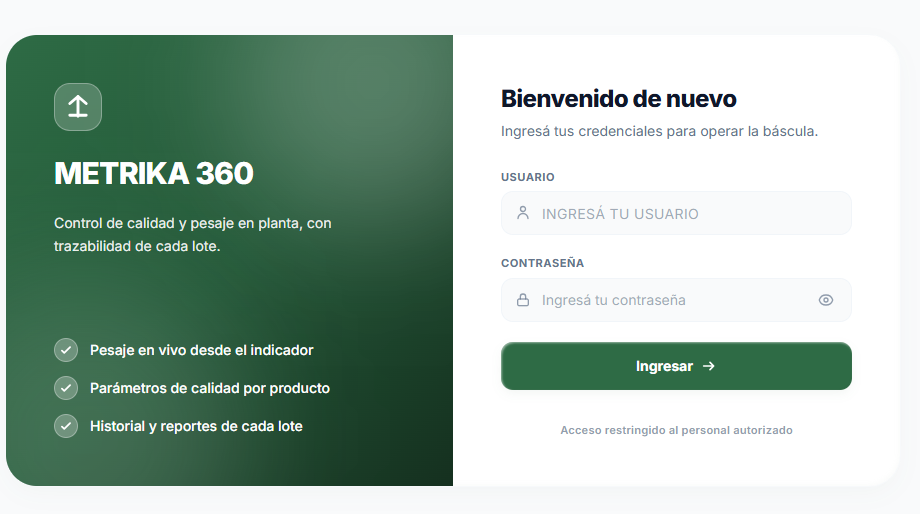
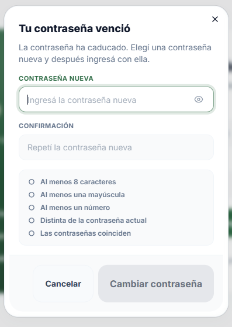
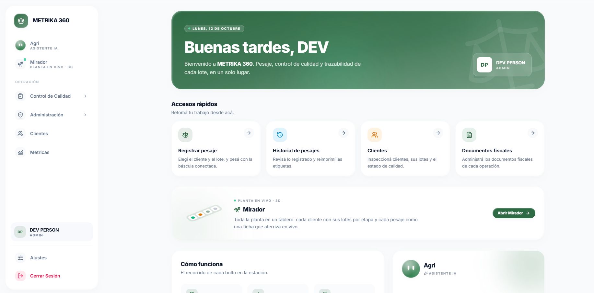
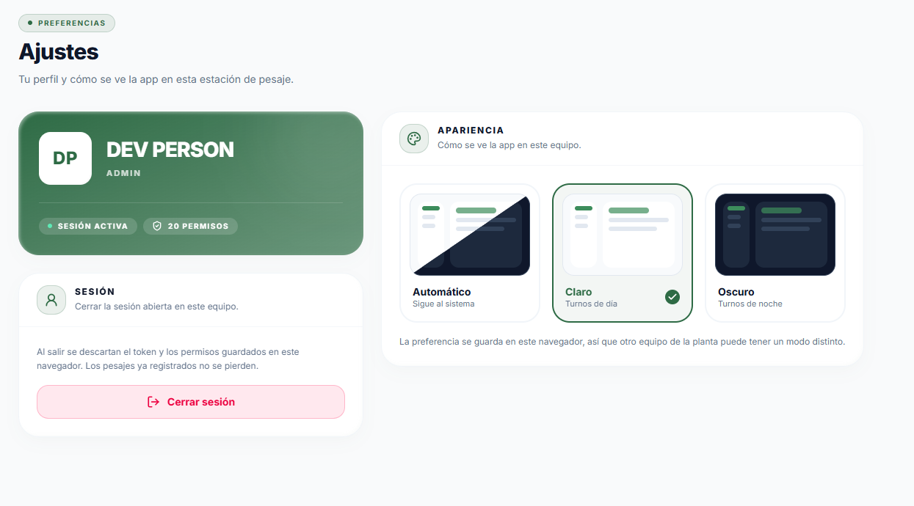
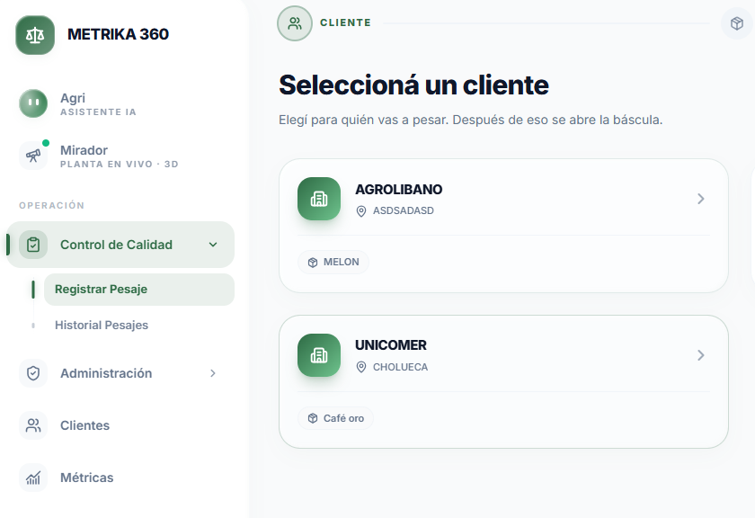
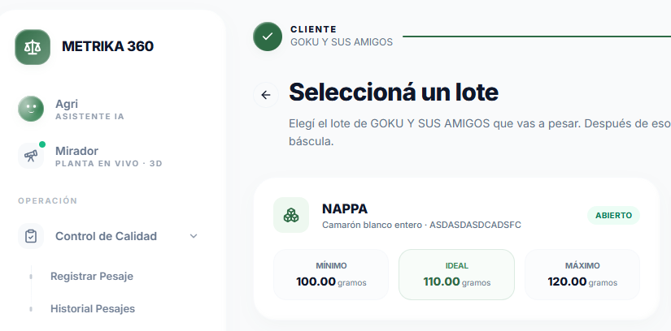
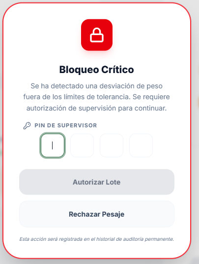
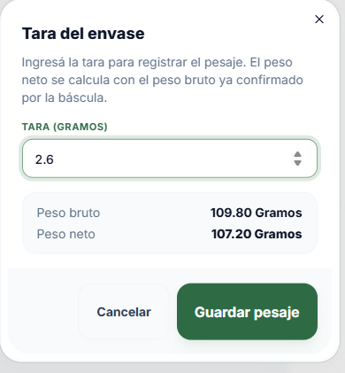
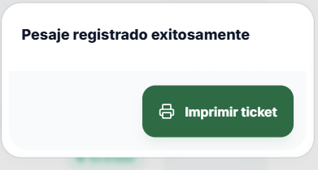

      

# METRIKA 360

## Manual de usuario

 

**Versión 1.0 · Sin publicar**

      

Control de calidad de pesajes en planta

## Índice

1. [Introducción](#cap-1)
   1. [Qué es METRIKA 360](#cap-1-1)
   2. [Los roles y qué hace cada uno](#cap-1-2)
   3. [El ciclo de un lote](#cap-1-3)
2. [Requisitos](#cap-2)
   1. [Navegador](#cap-2-1)
   2. [Conectar la báscula](#cap-2-2)
   3. [Estados de la báscula](#cap-2-3)
3. [Primeros pasos](#cap-3)
   1. [Ingresar](#cap-3-1)
   2. [Contraseña vencida](#cap-3-2)
   3. [La portada y el menú lateral](#cap-3-3)
   4. [Ajustes](#cap-3-4)
4. [Operador](#cap-4)
   1. [Registrar un pesaje](#cap-4-1)
   2. [El rango de peso y los estados de calidad](#cap-4-2)
   3. [Peso sobre el máximo: el Bloqueo Crítico](#cap-4-3)
   4. [Imprimir el ticket](#cap-4-4)
   5. [Crear un cliente y crear un lote](#cap-4-5)
   6. [Inspección de clientes, lotes y pesajes](#cap-4-6)
   7. [Aprobar o rechazar un lote](#cap-4-7)
   8. [Historial de pesajes](#cap-4-8)
5. [Supervisor](#cap-5)
   1. [Autorizar un peso con el PIN](#cap-5-1)
   2. [Inspección y rechazo de pesajes](#cap-5-2)
   3. [Agri, el asistente con IA](#cap-5-3)
   4. [Mirador: la planta en vivo](#cap-5-4)
   5. [Métricas de calidad](#cap-5-5)
6. [Administrador](#cap-6)
   1. [Qué ve el administrador](#cap-6-1)
   2. [Rechazar un cliente](#cap-6-2)
   3. [Tareas fuera de la pantalla](#cap-6-3)
7. [Aprobador](#cap-7)
   1. [Dónde entra en el ciclo del lote](#cap-7-1)
   2. [La aplicación móvil](#cap-7-2)
8. [Solución de problemas](#cap-8)
9. [Glosario](#cap-9)

[Anexo A. Qué ve cada rol](#cap-anexo-a)

[Historial de versiones](#cap-historial)

## 1. Introducción

### 1.1 Qué es METRIKA 360

METRIKA 360 es el sistema de control de calidad de pesajes en planta. Lee el peso directamente del indicador de la báscula, lo compara con el rango definido para cada lote y registra cada pesaje con su ticket impreso.

Con METRIKA 360 usted puede:

- Registrar pesajes con la báscula conectada al equipo, sin escribir el peso a mano.
- Saber al instante si un peso está dentro del rango del lote (mínimo, ideal y máximo).
- Exigir la autorización de un supervisor cuando un peso supera el máximo.
- Imprimir el ticket que identifica cada bulto.
- Consultar el historial de pesajes y el estado de cada cliente y cada lote.
- Seguir la planta en vivo, consultar métricas de calidad y hacer preguntas a un asistente con inteligencia artificial.

### 1.2 Los roles y qué hace cada uno

Cada usuario tiene un rol. El rol decide qué módulos ve en el menú lateral y qué acciones puede hacer. Si le falta un módulo que necesita para su trabajo, pídale al administrador del sistema que revise su rol.

| Rol | Qué hace | Capítulo |
| --- | --- | --- |
| **Operador** | Registra los pesajes en la báscula, crea clientes y lotes, y revisa el historial. | [4](#cap-4) |
| **Supervisor** | Autoriza con su PIN los pesos que superan el máximo, inspecciona lotes y pesajes, y consulta el Mirador, las métricas y el asistente Agri. | [5](#cap-5) |
| **Administrador** | Tiene acceso a todos los módulos del sistema. | [6](#cap-6) |
| **Aprobador** | Aprueba los lotes y sus pesajes desde la aplicación móvil. | [7](#cap-7) |

El detalle de qué pantallas ve cada rol está en el [Anexo A](#cap-anexo-a).

### 1.3 El ciclo de un lote

Un lote es un conjunto de bultos de un mismo producto para un cliente. Cada lote pasa por estas etapas:

1. **En proceso.** El lote está abierto y recibe pesajes en la báscula.
2. **Cliente final.** Se terminó de pesar y alguien con permiso aprobó el lote. El lote ya no recibe pesajes y queda esperando la revisión del aprobador.
3. **Finalizado.** El aprobador revisó los pesajes desde la aplicación móvil y dio el lote por terminado.

En las etapas **En proceso** y **Cliente final**, un lote también puede **rechazarse**. Un lote rechazado sale del ciclo y no recibe más pesajes.

## 2. Requisitos

### 2.1 Navegador

METRIKA 360 se usa desde el navegador, sin instalar nada en el equipo.

- **Para pesar**, el equipo de la báscula necesita **Google Chrome** o **Microsoft Edge** en una computadora de escritorio o portátil. Otros navegadores (Firefox, Safari) y los celulares no pueden leer la báscula.
- **Para el resto de los módulos** sirve cualquier navegador actualizado. Salvo la báscula, el sistema también se puede abrir desde el celular.

Si abre la pantalla de pesaje en un navegador que no puede leer la báscula, verá el aviso *"Este navegador no permite leer la báscula. Abra el sistema en Chrome o Edge de escritorio."*

### 2.2 Conectar la báscula

El indicador de la báscula se conecta a la computadora por un cable USB o por un adaptador serial a USB.

**La primera vez en un equipo** hay que darle permiso al navegador para usar la báscula:

1. Conecte el cable del indicador a la computadora y encienda el indicador.
2. Entre a la pantalla de pesaje (vea el [capítulo 4.1](#cap-4-1)).
3. Pulse **Conectar Báscula**. Se abre el diálogo **Seleccionar báscula**.
4. Pulse **Autorizar báscula nueva**. El navegador muestra su propia lista de dispositivos.
5. Elija el puerto de la báscula en la lista del navegador y pulse **Conectar**.
6. El sistema le pide un nombre para reconocerla después, por ejemplo *Báscula Piso 1*. Escríbalo y pulse **Guardar**.

Cuando la báscula se conecta, aparece el aviso **Báscula conectada**, con la lectura en vivo, el cliente y el lote. Se cierra solo en unos segundos, o con **Empezar a pesar**.

**Las veces siguientes** no hace falta repetir el permiso:

- Al entrar a la pantalla de pesaje, el sistema se conecta solo a la última báscula que usó en ese equipo.
- Si no se conecta sola, pulse **Conectar Báscula** y elija la báscula de la lista. La última que usó aparece marcada como **Preferida**.

El permiso y el nombre de la báscula quedan guardados en ese navegador y en ese equipo. En otro equipo, o en otro navegador, hay que autorizarla de nuevo.

### 2.3 Estados de la báscula

Arriba a la derecha de la pantalla de pesaje, una etiqueta muestra el estado de la conexión con la báscula:

| Estado | Qué significa | Qué hacer |
| --- | --- | --- |
| **Báscula en línea** | La báscula está conectada y enviando el peso. | Puede pesar. |
| **Conectando…** | El sistema está abriendo la conexión. | Esperar unos segundos. |
| **Sin señal** | La conexión está abierta, pero el indicador dejó de enviar el peso hace más de 4 segundos. | Verificar que el indicador esté encendido y que el cable esté firme. Si la señal vuelve, el estado se recupera solo; si no, pulsar **Reintentar**. |
| **Reconectando… (n/6)** | Se perdió la conexión y el sistema intenta recuperarla solo, hasta 6 veces. | Revisar el cable mientras tanto. |
| **Desconectada** | No hay conexión con la báscula. | Pulsar **Conectar Báscula**. |
| **Error de puerto** | No se pudo abrir la conexión con la báscula. | Revisar el cable y pulsar **Reintentar**. Si sigue, desconectar y volver a conectar el cable. |
| **Navegador no compatible** | El navegador no puede leer la báscula. | Abrir el sistema en Chrome o Edge de escritorio. |

**Mientras la báscula no está en línea, no se pueden registrar pesajes.** Debajo del encabezado aparece una franja que explica el problema, y en verde *"Comunicación con la báscula restablecida."* cuando la conexión vuelve.

**Si la conexión se corta**, el sistema avisa de tres formas para que lo note aunque no esté mirando la pantalla: emite tres pitidos, hace parpadear el título de la pestaña del navegador y abre un aviso con:

- el motivo del corte (por ejemplo, **Báscula desconectada** o **Báscula sin señal**);
- la **Hora del corte** y la **Última lectura**;
- los botones **Reintentar conexión** y **Entendido, seguir sin báscula**.

Si el corte ocurrió en medio de un pesaje, el aviso lo dice: *"El pesaje en curso quedó invalidado. Retire el producto, reconecte la báscula y repita la muestra."* Ese pesaje no se guardó y hay que volver a pesarlo.

## 3. Primeros pasos

Este capítulo vale para todos los roles.

### 3.1 Ingresar

*La pantalla de ingreso.*

1. Abra en el navegador la dirección de METRIKA 360 que le dio su empresa.
2. En **Usuario**, escriba su usuario. Se convierte a mayúsculas solo.
3. En **Contraseña**, escriba su contraseña. Con el ícono del ojo puede verla mientras la escribe.
4. Pulse **Ingresar**.

Al ingresar, el sistema lo lleva a la portada.

**Qué pasa si…**

- **Los datos no son correctos.** El error aparece en rojo debajo de los campos. Revise el usuario y la contraseña, y vuelva a intentarlo.
- **Su contraseña venció.** Se abre el diálogo para cambiarla. Siga el [capítulo 3.2](#cap-3-2).
- **No ve ningún módulo después de ingresar.** La portada dice *"Todavía no tenés módulos habilitados"*. Su usuario no tiene permisos asignados: pídale al administrador del sistema que los revise.

La sesión queda abierta en ese navegador hasta que usted la cierre (vea el [capítulo 3.4](#cap-3-4)). Si se le asignan permisos nuevos, tiene que cerrar sesión y volver a ingresar para verlos.

### 3.2 Contraseña vencida

Las contraseñas vencen. Además, **todo usuario nuevo empieza con la contraseña vencida**, así que la primera vez que ingrese tendrá que cambiarla.

*El diálogo para elegir una contraseña nueva, con sus requisitos.*

1. Ingrese con su usuario y su contraseña actual, como siempre. Se abre el diálogo **Tu contraseña venció**.
2. En **Contraseña nueva**, escriba la contraseña nueva.
3. En **Confirmación**, repítala.
4. Revise la lista de requisitos. Cada uno se marca en verde cuando se cumple:
   - Al menos 8 caracteres.
   - Al menos una mayúscula.
   - Al menos un número.
   - Distinta de la contraseña actual.
   - Las contraseñas coinciden.
5. Cuando se cumplen todos, pulse **Cambiar contraseña**.
6. Aparece el aviso *"Ingresá con tu contraseña nueva."* El diálogo se cierra y el campo de contraseña queda vacío.
7. Escriba la contraseña nueva y pulse **Ingresar**.

Cambiar la contraseña **no** lo hace ingresar solo: hay que ingresar con la nueva, como en el paso 7.

**Qué pasa si…**

- **Cierra el diálogo sin cambiar la contraseña.** Puede cerrarlo con **Cancelar**, con la X o con la tecla Esc. Su contraseña sigue vencida, y el diálogo vuelve a abrirse la próxima vez que ingrese.
- **El cambio falla.** El error aparece dentro del diálogo, que sigue abierto. Corrija lo que indique y vuelva a pulsar **Cambiar contraseña**.

### 3.3 La portada y el menú lateral

*La portada de un administrador, con todos los módulos en el menú lateral.*

La **portada** es lo primero que ve al ingresar. Tiene:

- Un saludo con su nombre, la fecha y su rol.
- **Accesos rápidos** a los módulos que su rol tiene habilitados: **Registrar pesaje**, **Historial de pesajes** y **Clientes**.
- La tarjeta del **Mirador** y la de **Agri**, si su rol las tiene.
- **Cómo funciona**, el recorrido de cada bulto en tres pasos: seleccionar, pesar y etiquetar.

El **menú lateral**, a la izquierda, está siempre a la vista. Muestra solo lo que su rol puede usar:

| Item del menú | Para qué sirve | Capítulo |
| --- | --- | --- |
| **Agri** · Asistente IA | Hacer preguntas sobre lotes, pesajes y calidad. | [5.3](#cap-5-3) |
| **Mirador** · Planta en vivo · 3D | Ver la planta en vivo. | [5.4](#cap-5-4) |
| **Control de Calidad** → **Registrar Pesaje** | Pesar con la báscula. | [4.1](#cap-4-1) |
| **Control de Calidad** → **Historial Pesajes** | Consultar lo pesado. | [4.8](#cap-4-8) |
| **Clientes** | Inspeccionar clientes, lotes y pesajes. | [4.6](#cap-4-6) |
| **Métricas** | Ver los indicadores de calidad. | [5.5](#cap-5-5) |

**Control de Calidad** es un grupo: púlselo para abrir o cerrar sus opciones.

Al pie del menú están su nombre y su rol, **Ajustes** y **Cerrar Sesión**.

### 3.4 Ajustes

*Ajustes: perfil, apariencia y sesión.*

En **Ajustes**, al pie del menú lateral, encontrará:

- **Su perfil**: su nombre, su rol y cuántos permisos tiene.
- **Apariencia**: cómo se ve el sistema en este equipo.
  - **Automático** sigue la configuración de la computadora.
  - **Claro** está pensado para los turnos de día.
  - **Oscuro** está pensado para los turnos de noche.

  La elección se guarda en este navegador, así que otro equipo de la planta puede tener un modo distinto.
- **Sesión**: el botón **Cerrar sesión**.

**Cerrar sesión.** Pulse **Cerrar sesión** en Ajustes, o **Cerrar Sesión** al pie del menú lateral. El sistema vuelve a la pantalla de ingreso. Los pesajes ya registrados no se pierden.

Cierre la sesión siempre que deje un equipo compartido. Mientras siga abierta, cualquiera que use ese equipo trabaja con su usuario.

## 4. Operador

Este capítulo explica el trabajo diario en la báscula. Antes de pesar por primera vez en un equipo, lea el [capítulo 2](#cap-2) para conectar la báscula.

### 4.1 Registrar un pesaje

Registrar un pesaje tiene cuatro pasos, que la pantalla muestra arriba: **Cliente**, **Lote**, **Pesar** y **Etiqueta**. Los pasos ya completados muestran lo que eligió, y puede pulsarlos para volver a ese paso.

**Paso 1. Elegir el cliente**

*La pantalla Seleccioná un cliente.*

1. En el menú lateral, abra **Control de Calidad** y pulse **Registrar Pesaje**.
2. Aparecen los clientes que tiene asignados. Pulse la tarjeta del cliente para el que va a pesar.

Si la pantalla dice *"No hay clientes asignados"*, su usuario no está vinculado a ningún cliente. Los operadores se vinculan al crear el cliente (vea el [capítulo 4.5](#cap-4-5)). Pídale al administrador del sistema que revise el vínculo.

**Paso 2. Elegir el lote**

*Los lotes del cliente, con su rango de peso.*

1. Aparecen los lotes del cliente. Cada tarjeta muestra el producto, la variedad o talla y el rango del lote: **Mínimo**, **Ideal** y **Máximo**.
2. Pulse la tarjeta del lote que va a pesar. Se abre la pantalla de pesaje.

Si la pantalla dice *"Este cliente no tiene lotes"*, hay que crear uno primero (vea el [capítulo 4.5](#cap-4-5)).

**Paso 3. Pesar**

*La pantalla de pesaje con la báscula todavía desconectada.*

La pantalla de pesaje tiene tres partes:

- **La lectura de la báscula**, en el centro, con el botón **Registrar pesaje**.
- **Detalles de Operación**, con el cliente y el lote que eligió.
- **Parámetros de Referencia**, con el rango del lote y dónde cae el peso actual.

1. Verifique que la etiqueta de arriba a la derecha diga **Báscula en línea**. Si no, conéctela como se explica en el [capítulo 2.2](#cap-2-2).
2. Coloque el producto sobre la plataforma.
3. Espere a que el peso se estabilice. Mientras tanto aparece una cuenta regresiva de **5 segundos** con el aviso *"No retire ni mueva el producto de la plataforma."*
   - Si el peso se mueve, la cuenta vuelve a empezar y aparece *"El peso se movió: el conteo volvió a empezar."*
4. Cuando el peso está estable y dentro del rango, la lectura dice **Aprobado** y debajo aparece *"Peso estable y dentro de rango: listo para registrar."*
5. Pulse **Registrar pesaje**. Se abre el diálogo **Tara del envase**.

*Un peso estable dentro del rango, listo para registrar.*

*El diálogo Tara del envase, con el peso bruto y el neto.*

6. En **Tara**, escriba el peso del envase, en la unidad del lote.
7. Revise el **Peso bruto** (el que leyó la báscula) y el **Peso neto** (el bruto menos la tara).
8. Pulse **Guardar pesaje**.

Cuando el pesaje se guarda, aparece un aviso en verde y se abre el diálogo del ticket. Siga el [capítulo 4.4](#cap-4-4).

**Qué pasa si…**

- **El botón Registrar pesaje no se puede pulsar.** El peso todavía no está estable, la plataforma está vacía o el peso está fuera del rango. El texto debajo del botón le dice cuál de los tres casos es.
- **El peso está por debajo del mínimo.** La lectura dice **Desviado** y aparece *"Falta producto: el peso está por debajo del mínimo del lote."* Agregue producto hasta entrar en el rango.
- **El peso está por encima del máximo.** Se abre el **Bloqueo Crítico**. Siga el [capítulo 4.3](#cap-4-3).
- **La tara no es válida.** El diálogo lo indica: *"Tara requerida"*, *"La tara no puede ser negativa"* o *"La tara debe ser menor al peso bruto"*.
- **El peso cambia con el diálogo de tara abierto.** El diálogo muestra *"El peso cambió — reestabilizando…"* y no permite guardar hasta que el peso vuelva a quedar estable.
- **Quiere descartar la muestra.** Pulse **Cancelar** en el diálogo de tara. No se guarda nada y la báscula vuelve a estabilizar.
- **No se pudo guardar.** Aparece un aviso en rojo con el motivo. El diálogo de tara sigue abierto para que pueda reintentar.

Para cambiar de cliente o de lote, use la flecha de arriba a la izquierda, que vuelve a la lista de clientes, o pulse los pasos **Cliente** o **Lote**.

### 4.2 El rango de peso y los estados de calidad

Cada lote tiene tres pesos de referencia:

- **Mínimo**: el peso más bajo aceptado.
- **Ideal**: el peso buscado.
- **Máximo**: el peso más alto aceptado.

Todo peso entre el mínimo y el máximo está **dentro del rango**.

La tarjeta **Parámetros de Referencia** indica en todo momento dónde cae el peso que está sobre la báscula:

| Indicador | Qué significa |
| --- | --- |
| **Sin producto** | La plataforma está vacía. |
| **Bajo el mínimo** | Falta producto. La tarjeta indica cuánto falta para llegar al mínimo. |
| **En rango** | El peso está dentro del rango del lote. |
| **En el ideal** | El peso está dentro del rango y muy cerca del ideal. |
| **Sobre el máximo** | Sobra producto. La tarjeta indica cuánto sobra. |

Lecturas de 2 o menos se consideran plataforma vacía y se muestran como 0.

Cada pesaje guardado queda con un **estado de calidad**, que se ve en el historial y en la inspección. El sistema lo calcula sobre el **peso neto**, es decir, después de descontar la tara:

- **Peso ideal**: el neto quedó dentro del rango.
- **Peso máximo**: el neto quedó por encima del máximo.
- **Peso mínimo**: el neto quedó por debajo del mínimo.

La báscula controla el peso **bruto**. Por eso un pesaje aprobado en la báscula puede quedar como **Peso mínimo** si la tara es grande.

### 4.3 Peso sobre el máximo: el Bloqueo Crítico

Cuando un peso estable supera el máximo del lote, el sistema no deja seguir sin la autorización de un supervisor. Se abre el diálogo **Bloqueo Crítico**.

*El Bloqueo Crítico pidiendo el PIN del supervisor.*

Hay dos caminos:

**A. Corregir el peso.** Es lo habitual cuando sobra producto:

1. Pulse **Rechazar Pesaje**. La muestra se descarta, sin guardar nada.
2. Quite producto de la plataforma.
3. Espere a que el peso se estabilice dentro del rango y continúe como siempre.

Si el peso vuelve a estabilizarse por encima del máximo, el bloqueo aparece de nuevo.

**B. Guardar el peso con autorización.** Cuando el peso es correcto aunque supere el máximo:

1. Llame a un supervisor.
2. El supervisor escribe su **PIN de supervisor**, de 4 dígitos, en el diálogo y pulsa **Autorizar Lote**.
3. El bloqueo se cierra y se abre solo el diálogo **Tara del envase**, con la línea *"Autorizado por"* y el nombre del supervisor.
4. Complete la tara y pulse **Guardar pesaje**, como en el [capítulo 4.1](#cap-4-1).

*El diálogo de tara después del PIN, con el nombre del supervisor.*

El sistema registra qué supervisor autorizó el pesaje. Cada PIN es personal: el supervisor no debe compartirlo.

La autorización vale para **un solo pesaje**. Se descarta al guardar, al cancelar la tara o si el peso cambia antes de guardar. El bulto siguiente que supere el máximo vuelve a pedir el PIN.

**Qué pasa si…**

- **El PIN es incorrecto.** El diálogo muestra *"El PIN ingresado es incorrecto."* y vacía el campo. Vuelva a escribirlo.
- **Aparece "Error al validar el PIN. Intente de nuevo."** El sistema no pudo comprobar el PIN, por ejemplo por un problema de conexión. Espere unos segundos y vuelva a intentar.
- **Al guardar aparece un aviso de autorización inválida.** La tara se cierra y el bloqueo vuelve a aparecer sobre la misma muestra. El supervisor tiene que escribir su PIN de nuevo.
- **La tara deja el peso neto dentro del rango.** El pesaje se guarda normalmente. No necesitaba autorización, así que no queda registrado ningún supervisor.

### 4.4 Imprimir el ticket

Todo pesaje guardado se cierra imprimiendo su ticket. **El ticket es obligatorio**: un bulto sin etiqueta después no se puede identificar en la planta. Por eso el diálogo **Pesaje registrado exitosamente** no se puede cerrar con la X, con la tecla Esc ni haciendo clic afuera.

*El diálogo del ticket, que se abre después de cada pesaje.*

1. Pulse **Imprimir ticket**. El botón dice *"Abriendo impresión…"* mientras se prepara el ticket.
2. Se abre el diálogo de impresión del navegador. Elija la impresora de etiquetas y pulse **Imprimir**.
3. Verifique que el ticket salió de la impresora y péguelo en el bulto.
4. Pulse **Ya lo imprimí**.

El diálogo se cierra y la pantalla queda lista para el bulto siguiente, con el mismo cliente y el mismo lote. Si todavía hay producto sobre la plataforma, la cuenta regresiva empieza de nuevo.

Si el ticket no salió bien, pulse **Volver a imprimir** antes de **Ya lo imprimí**.

**Qué pasa si…**

- **La impresión falla.** Aparece un aviso en rojo y el diálogo muestra *"No se pudo abrir la impresión de la etiqueta. Reintentá."* Pulse **Reintentar impresión**.
- **La impresión falla dos veces seguidas.** Aparece el botón **Continuar sin imprimir**. Úselo solo si no hay forma de imprimir, por ejemplo si el servicio de tickets está caído. El pesaje ya quedó guardado, pero el bulto queda sin etiqueta: avísele a su supervisor.

### 4.5 Crear un cliente y crear un lote

Los clientes y los lotes se crean desde **Clientes**, en el menú lateral. No todos los usuarios tienen estos botones: depende de su rol.

**Crear un cliente**

*El formulario Nuevo cliente.*

1. En el menú lateral, pulse **Clientes**.
2. Pulse **Crear Nuevo cliente**. Se abre el formulario **Nuevo cliente**.
3. Complete los datos: **Nombre**, **RTN**, **Código de exportación**, **Correo de contacto**, **Teléfono**, **Dirección de planta** y **Producto**.
4. En **Operadores que estaran vinculados a este cliente**, elija uno o más operadores. Solo los operadores vinculados pueden pesar para este cliente.
5. Pulse **Crear cliente**.

El nombre, el RTN, el código de exportación, el producto y al menos un operador son obligatorios.

**Crear un lote**

*El formulario Nuevo lote, con el rango de peso.*

1. En el menú lateral, pulse **Clientes**.
2. En la fila del cliente, pulse el botón **⋯** y elija **Ver lotes pendientes de inspección**.
3. Pulse **Crear nuevo lote**. Se abre el formulario **Nuevo lote**.
4. Complete **Nombre del lote**, **Variedad o talla**, **Unidad de medida** y **Producto**.
5. Complete el rango: **Peso mínimo**, **Peso ideal** y **Peso máximo**, en la unidad de medida que eligió.
6. Pulse **Crear lote**.

Los tres pesos tienen que ser mayores que 0, y el mínimo no puede ser mayor que el ideal ni el ideal mayor que el máximo. **Revise el rango con cuidado**: es el que la báscula usa para aprobar o bloquear cada pesaje del lote.

### 4.6 Inspección de clientes, lotes y pesajes

**Clientes**, en el menú lateral, permite revisar todos los clientes, sus lotes y cada pesaje.

*La inspección de clientes, con los filtros y la tabla.*

**La lista de clientes**

- Para buscar un cliente, use los filtros **Nombre del cliente**, **Producto**, **Código de exportación** o **RTN**, y pulse **Buscar**. **Limpiar Filtros** vuelve a mostrar todos.
- La tabla muestra 20 clientes por página. Use **Anterior** y **Siguiente** para pasar de página.
- Cada fila tiene un botón **⋯** con las acciones sobre ese cliente:
  - **Ver lotes pendientes de inspección**: todos los lotes del cliente.
  - **Ver lotes finalizados por aprobador**: los lotes que el aprobador ya dio por terminados.

**Los lotes de un cliente**

**Ver lotes pendientes de inspección** muestra una tarjeta por lote, activos e inactivos. Pulse una tarjeta para ver sus pesajes.

**Los pesajes de un lote**

*Los pesajes de un lote, con los botones para aprobarlo o rechazarlo.*

La pantalla **Pesajes registrados** muestra:

- Los datos del lote.
- Los botones **Aprobar lote** y **Rechazar lote** (vea el [capítulo 4.7](#cap-4-7)).
- Una tabla con todos los pesajes del lote: fecha, peso bruto, tara, peso neto, estado de calidad, si está fuera de rango y quién lo registró.

Puede filtrar los pesajes por **Usuario**, por fecha (**Desde** y **Hasta**) o por **Fuera de rango**.

**Volver a descargar un ticket.** En la fila del pesaje, pulse **⋯** y elija **Descargar etiqueta**. El ticket se descarga como PDF, para imprimirlo de nuevo.

**Los lotes finalizados**

**Ver lotes finalizados por aprobador** muestra los lotes que el aprobador ya terminó, con quién lo aprobó y quién lo finalizó. Desde ahí puede:

- **Descargar Reporte de lotes finalizados**, en PDF o en Excel, opcionalmente entre dos fechas de finalización.
- **Ver resumen del lote**: un resumen del lote escrito por inteligencia artificial.

### 4.7 Aprobar o rechazar un lote

Cuando se terminó de pesar un lote, hay que aprobarlo para que pase a la revisión del aprobador (vea el [capítulo 1.3](#cap-1-3)).

**Aprobar un lote**

1. Abra los pesajes del lote, como en el [capítulo 4.6](#cap-4-6).
2. Revise los pesajes.
3. Pulse **Aprobar lote**. El sistema pide confirmación.
4. Pulse **Aprobar lote** de nuevo para confirmar.

El lote pasa a **cliente final** y ya no recibe pesajes. El sistema vuelve a la lista de clientes. Un lote sin pesajes no se puede aprobar.

**Rechazar un lote**

1. Abra los pesajes del lote.
2. Pulse **Rechazar lote**.
3. En **Motivo del rechazo**, explique por qué se rechaza. Debe tener al menos 5 caracteres.
4. Pulse **Rechazar lote** para confirmar.

**Aprobar y rechazar no se pueden deshacer.** Revise bien el lote antes de confirmar.

### 4.8 Historial de pesajes

**Historial Pesajes**, dentro de **Control de Calidad** en el menú lateral, muestra los pesajes que usted registró.

*El historial de pesajes, con los filtros.*

- Para buscar, use los filtros **Nombre de lote**, **Cliente**, fechas **Desde** y **Hasta**, y **Fuera de rango**. Luego pulse **Buscar**. **Limpiar Filtros** vuelve a mostrar todo.
- La tabla muestra, por cada pesaje: fecha, lote, unidad, peso bruto, tara, peso neto, estado de calidad y si quedó fuera de rango.
- Se muestran 20 pesajes por página. Use **Anterior** y **Siguiente** para pasar de página.

Para volver a descargar el ticket de un pesaje, búsquelo desde **Clientes**, en los pesajes de su lote (vea el [capítulo 4.6](#cap-4-6)).

## 5. Supervisor

El supervisor autoriza los pesos fuera de rango, revisa lotes y pesajes, y sigue la operación con el Mirador, las métricas y el asistente Agri.

Desde **Clientes** también puede inspeccionar y aprobar o rechazar lotes, igual que el operador (vea los capítulos [4.6](#cap-4-6) y [4.7](#cap-4-7)).

### 5.1 Autorizar un peso con el PIN

Cuando un peso supera el máximo del lote, la pantalla de pesaje del operador se bloquea hasta que un supervisor lo autoriza. El procedimiento completo está en el [capítulo 4.3](#cap-4-3).

Lo que el supervisor tiene que saber:

- **El PIN se escribe en la pantalla del operador**, en el campo **PIN de supervisor**, y se confirma con **Autorizar Lote**. No hace falta ingresar al sistema con su propio usuario.
- **El PIN es personal y tiene 4 dígitos.** Identifica al supervisor que autoriza: el pesaje queda registrado a su nombre, y su nombre aparece en el diálogo de tara como *"Autorizado por"*.
- **No comparta su PIN.** Quien lo conozca puede autorizar pesajes en su nombre.
- **Cada autorización vale para un solo pesaje.** El bulto siguiente que supere el máximo vuelve a pedir el PIN.
- **Antes de autorizar, mire el peso.** Si sobra producto, lo correcto es pedirle al operador que lo corrija con **Rechazar Pesaje**, no autorizarlo.

El PIN lo asigna el administrador del sistema. Si no tiene uno, o si lo olvidó, pídale uno nuevo.

### 5.2 Inspección y rechazo de pesajes

Desde los pesajes de un lote (vea el [capítulo 4.6](#cap-4-6)), el supervisor puede rechazar un pesaje ya guardado, por ejemplo si se registró en el lote equivocado.

1. En el menú lateral, pulse **Clientes**.
2. En la fila del cliente, pulse **⋯** y elija **Ver lotes pendientes de inspección**.
3. Pulse la tarjeta del lote.
4. En la fila del pesaje, pulse **⋯** y elija **Rechazar Pesaje**.
5. En **Motivo del rechazo**, explique por qué. Debe tener al menos 5 caracteres.
6. Pulse **Rechazar pesaje** para confirmar.

**El rechazo no se puede deshacer.** El pesaje queda fuera de la inspección del lote.

### 5.3 Agri, el asistente con IA

**Agri** responde preguntas sobre lotes, pesajes y calidad, escritas en lenguaje natural. Por ejemplo: *"¿Cuántos pesajes fuera de rango hubo hoy?"*

*Agri respondiendo una pregunta.*

1. En el menú lateral, pulse **Agri**.
2. Escriba su pregunta en el recuadro de abajo.
   - También puede pulsar una de las tres sugerencias que aparecen al empezar: se envía sola.
3. Pulse la flecha, o la tecla **Enter**, para enviarla. Para escribir en otra línea sin enviar, use **Shift + Enter**.
4. Mientras Agri prepara la respuesta, aparecen tres puntos animados. La respuesta puede incluir listas y tablas.

Bajo la última respuesta hay dos botones:

- **Copiar**: copia la respuesta para pegarla en otro lado.
- **Regenerar**: pide otra respuesta a la misma pregunta.

Para empezar de cero, pulse **Nueva conversación**.

Tenga en cuenta:

- **Agri solo consulta.** No aprueba, no rechaza ni modifica nada.
- **Agri puede equivocarse.** Verifique en las pantallas del sistema cualquier dato importante antes de tomar una decisión.
- **Cada pregunta tiene un máximo de 500 caracteres.** Si se pasa, aparece *"El mensaje no puede pasar de 500 caracteres."* y el mensaje no se envía.
- **Hay un límite de preguntas por día.** Si lo alcanza, Agri se lo dice en su respuesta.
- **La conversación no se guarda.** Si recarga la página o sale de Agri, se pierde.

### 5.4 Mirador: la planta en vivo

El **Mirador** muestra toda la planta en un tablero en tres dimensiones:

- cada cliente es un territorio;
- sus lotes avanzan por las etapas **En pesaje**, **Por aprobar** y **Finalizado**;
- cada pesaje nuevo vuela desde la báscula hasta su lote.

*El Mirador con un lote seleccionado.*

**Los indicadores del día**

Arriba a la izquierda están **Pesajes hoy**, **Peso neto hoy**, **En rango** (el porcentaje de pesajes dentro del rango) y **Lotes activos**.

Al lado del título, el indicador **En vivo** muestra la hora de la última actualización. El tablero se actualiza solo, aproximadamente cada uno o dos minutos, mientras la pestaña está a la vista. Si pasan más de 4 minutos sin poder actualizar, el indicador cambia a *"Sin actualizar hace…"* y el tablero muestra los últimos datos que recibió.

**Moverse por el tablero**

- **Girar**: arrastre con el mouse.
- **Desplazar**: arrastre con el botón derecho, o con **Shift** presionado.
- **Acercar y alejar**: la rueda del mouse, o los botones **+** y **−**.
- **Volver a la vista de toda la planta**: el botón de la mira.
- **Pantalla completa**: el botón de las esquinas.

**Ver el detalle**

Pulse un cliente, un lote o la ficha de un pesaje para ver su detalle en el panel de la derecha.

- **Cliente**: sus lotes activos, sus bultos, el porcentaje en rango y sus lotes agrupados por etapa.
- **Lote**: el rango, los bultos, el peso neto, la **Diana de calidad** y los **Últimos pesajes**.
- **Pesaje**: el peso, si quedó en rango, cuánto se alejó del ideal, el operario y la hora.

Para volver un nivel atrás, use la ruta de arriba (**Planta › cliente › lote**), pulse un espacio vacío del tablero o la tecla **Esc**.

**Cómo leer las fichas y la diana**

- **Ficha verde**: pesaje en rango.
- **Ficha ámbar**: en rango, pero cerca de un límite (a más del 60 % del camino hacia el mínimo o el máximo).
- **Ficha roja**: fuera de rango.

La **Diana de calidad** de un lote pone el peso ideal en el centro. Los pesajes más pesados quedan a la derecha y los más livianos a la izquierda. El anillo rojo marca los límites mínimo y máximo.

El panel **Cómo leer el tablero**, en la vista de la planta, explica el resto de los elementos. La gente en los pasillos y los carritos son ambientación, no datos.

**Qué pasa si…**

- **Aparece "Este equipo no puede dibujar el tablero 3D".** La computadora o el navegador no permiten dibujar en 3D. Los indicadores y el panel siguen funcionando. Pruebe con otro equipo, o pídale a soporte técnico que active la aceleración por hardware del navegador.

### 5.5 Métricas de calidad

**Métricas** resume la calidad de lo pesado en un período: cuánto quedó fuera de rango, cuánto se alejó del ideal y cómo se reparte por cliente.

*El tablero de métricas de calidad.*

**Elegir el período y los filtros**

Los filtros se aplican al momento, sin botón de buscar.

- **Período**: **7 días**, **30 días** (el que se ve al entrar), **90 días**, **Este mes** o **Personalizado**. Con **Personalizado** aparecen **Desde** y **Hasta** para elegir las fechas.
- **Cliente** y **Operador**: para ver solo un cliente o solo un operador.
  - Cada filtro activo aparece como una etiqueta, por ejemplo *Cliente: …*. Pulse su **×** para quitarlo.

Debajo del título se lee el período exacto que se está mostrando, por ejemplo *"Del 11 sep al 10 oct de 2026"*.

**Los indicadores**

| Indicador | Qué muestra |
| --- | --- |
| **Pesajes** | Cuántos pesajes hubo, cuántos se anularon y cuántos están sin revisar. |
| **Fuera de rango** | El porcentaje de pesajes con el peso neto fuera del rango del lote. |
| **Rechazo del aprobador** | De los pesajes que revisó el aprobador, qué porcentaje rechazó. |
| **Anulación** | El porcentaje de pesajes anulados. |

**Desviación frente al ideal** indica cuánto se alejan, en promedio, los pesajes del peso ideal:

- un valor **positivo** (en ámbar) significa que se pesa **por encima** del ideal: se entrega producto de más;
- un valor **negativo** (en rojo) significa que se pesa **por debajo**: hay riesgo de reclamo;
- un valor cerca de 0 significa que se pesa **en el ideal**.

La **dispersión (±)** indica cuánto varían los pesajes entre sí. El botón **?** de la tarjeta lo explica con ejemplos.

**Estados de calidad** reparte los pesajes entre peso ideal, máximo y mínimo.

**Por cliente** muestra los mismos indicadores para cada cliente. Pulse los títulos de las columnas para ordenar la tabla. Pulse la fila de un cliente para filtrar todo el tablero por ese cliente.

Un valor **—** significa que no hay datos para calcularlo. No es lo mismo que 0.

**Qué pasa si…**

- **Aparece "Sin pesajes en este período".** Elija un período más largo o quite algún filtro.
- **Aparece "No se pudieron cargar las métricas".** Pulse **Reintentar**. Los filtros siguen disponibles.

## 6. Administrador

### 6.1 Qué ve el administrador

El administrador tiene acceso a todos los módulos del sistema. Para cada uno, siga el capítulo que lo explica:

| Tarea | Capítulo |
| --- | --- |
| Registrar pesajes, imprimir tickets y consultar el historial | [4.1](#cap-4-1) a [4.4](#cap-4-4) y [4.8](#cap-4-8) |
| Crear clientes y lotes | [4.5](#cap-4-5) |
| Inspeccionar clientes, lotes y pesajes | [4.6](#cap-4-6) |
| Aprobar o rechazar lotes | [4.7](#cap-4-7) |
| Rechazar pesajes | [5.2](#cap-5-2) |
| Agri, Mirador y Métricas | [5.3](#cap-5-3) a [5.5](#cap-5-5) |

El administrador no puede autorizar un peso sobre el máximo: el PIN es solo de los supervisores (vea el [capítulo 5.1](#cap-5-1)).

El menú lateral del administrador también muestra **Administración**. Ese módulo no está cubierto por este manual.

### 6.2 Rechazar un cliente

Rechazar un cliente lo saca de la inspección. Es una acción que solo tiene el administrador.

1. En el menú lateral, pulse **Clientes**.
2. Busque al cliente con los filtros, si hace falta.
3. En la fila del cliente, pulse **⋯** y elija **Rechazar Cliente**.
4. En **Motivo del rechazo**, explique por qué. Debe tener al menos 5 caracteres.
5. Pulse **Rechazar cliente** para confirmar.

**El rechazo no se puede deshacer.** Revise bien el cliente antes de confirmar.

### 6.3 Tareas fuera de la pantalla

Algunas tareas de administración todavía no tienen pantalla en METRIKA 360. Las realiza el administrador del sistema, por fuera de las pantallas que describe este manual:

- Crear usuarios y asignarles su rol.
- Restablecer la contraseña de un usuario.
- Asignar el PIN a cada supervisor.
- Cambiar qué módulos ve cada rol.

Si necesita alguna de estas tareas, pídasela al administrador del sistema de su empresa.

## 7. Aprobador

### 7.1 Dónde entra en el ciclo del lote

El aprobador revisa los lotes que la planta ya terminó de pesar. Su trabajo empieza cuando un lote pasa a **cliente final** (vea el [capítulo 1.3](#cap-1-3)):

1. En la planta se pesa el lote, que está **en proceso**.
2. Alguien con permiso aprueba el lote en METRIKA 360, y el lote pasa a **cliente final** (vea el [capítulo 4.7](#cap-4-7)).
3. El aprobador revisa el lote y cada uno de sus pesajes. Puede aprobarlos o rechazarlos.
4. Si todo está en orden, el aprobador **finaliza** el lote. Si no, lo **rechaza** indicando el motivo.

Los lotes finalizados se pueden consultar desde **Clientes**, con **Ver lotes finalizados por aprobador** (vea el [capítulo 4.6](#cap-4-6)). Ahí se ve quién aprobó y quién finalizó cada lote.

### 7.2 La aplicación móvil

El aprobador no trabaja en las pantallas que describe este manual, sino en la **aplicación móvil de METRIKA 360**. Su uso se explica en el manual de esa aplicación.

## 8. Solución de problemas

**La báscula no aparece, o el sistema dice "Navegador no compatible".**

- Verifique que está usando **Google Chrome** o **Microsoft Edge** en una computadora. Otros navegadores y los celulares no pueden leer la báscula.
- Verifique que el cable del indicador esté conectado a la computadora y que el indicador esté encendido.
- Si es la primera vez en ese equipo o en ese navegador, autorice la báscula con **Autorizar báscula nueva** (vea el [capítulo 2.2](#cap-2-2)).
- Si el diálogo **Seleccionar báscula** dice *"Aún no hay básculas registradas"*, todavía no se autorizó ninguna en ese equipo. Use **Autorizar báscula nueva**.

**La báscula dice "Sin señal" o "Reconectando…".**

- **Sin señal**: la conexión está abierta, pero el indicador no envía el peso. Verifique que esté encendido y que el cable esté firme. Si la señal vuelve, el estado se recupera solo. Si no, pulse **Reintentar**.
- **Reconectando…**: el sistema perdió la conexión y la intenta recuperar solo, hasta 6 veces. Revise el cable mientras tanto.
- Si después de los reintentos la báscula queda **Desconectada**, desconecte y vuelva a conectar el cable, y pulse **Conectar Báscula**.
- Si había un pesaje en curso cuando se cortó, ese pesaje no se guardó. Retire el producto y vuelva a pesarlo.

Vea el detalle de cada estado en el [capítulo 2.3](#cap-2-3).

**Al ingresar, el sistema dice que la contraseña venció.**

Es normal la primera vez que ingresa un usuario nuevo, y cada vez que la contraseña vence. Elija una contraseña nueva en el diálogo **Tu contraseña venció** y luego ingrese con ella (vea el [capítulo 3.2](#cap-3-2)).

**El sistema dice "El PIN ingresado es incorrecto."**

- El supervisor tiene que escribir **su propio** PIN, de 4 dígitos.
- Si el supervisor no recuerda su PIN, o nunca recibió uno, el administrador del sistema tiene que asignarle uno nuevo.
- Si el mensaje es *"Error al validar el PIN. Intente de nuevo."*, el PIN no es el problema: el sistema no pudo comprobarlo. Espere unos segundos y vuelva a intentar.

**El ticket no se imprime.**

1. Verifique que la impresora de etiquetas esté encendida, con papel y conectada.
2. Pulse **Reintentar impresión**.
3. En el diálogo de impresión del navegador, verifique que esté elegida la impresora de etiquetas.
4. Si falla dos veces seguidas, aparece **Continuar sin imprimir**. Úselo solo si no hay forma de imprimir, y avísele a su supervisor: el bulto queda sin etiqueta.

El ticket de un pesaje ya guardado se puede descargar más tarde desde los pesajes de su lote (vea el [capítulo 4.6](#cap-4-6)).

**No veo un menú, un botón o un módulo que otro compañero sí ve.**

Cada rol ve solo los módulos y las acciones que tiene habilitados (vea el [Anexo A](#cap-anexo-a)).

- Si su trabajo necesita ese módulo, pídale al administrador del sistema que revise su rol.
- Si le acaban de habilitar algo nuevo, **cierre sesión y vuelva a ingresar**: los permisos se cargan al ingresar.

**La pantalla dice "No se pudo cargar la información", o aparece un aviso de que no se pudo contactar al servidor.**

El sistema no pudo comunicarse con el servidor.

1. Verifique que la computadora tenga conexión a internet o a la red de la planta.
2. Pulse **Reintentar**.
3. Si el problema sigue, espere unos minutos y vuelva a intentar. Si persiste, avísele a soporte técnico.

Mientras no hay conexión **no se pueden guardar pesajes**. No anote pesos a mano para cargarlos después sin consultarlo con su supervisor.

**El sistema me devolvió a la pantalla de ingreso.**

Su sesión terminó. Vuelva a ingresar con su usuario y su contraseña. Los pesajes que ya había guardado no se pierden.

## 9. Glosario

| Término | Significado |
| --- | --- |
| **Aprobador** | Rol que revisa los lotes en **cliente final** y los finaliza o rechaza, desde la aplicación móvil. |
| **Bloqueo Crítico** | Diálogo que detiene el pesaje cuando un peso estable supera el máximo del lote. Para continuar hace falta el PIN de un supervisor, o corregir el peso. |
| **Bulto** | Cada unidad de producto que se pesa y se etiqueta. |
| **Estado de calidad** | Clasificación de cada pesaje guardado según su peso neto: **peso ideal** (dentro del rango), **peso máximo** (por encima) o **peso mínimo** (por debajo). |
| **Etapa** | Momento del ciclo en que está un lote: **en proceso**, **cliente final**, **finalizado** o **rechazado**. |
| **Indicador** | El equipo de la báscula que muestra el peso y lo envía a la computadora. |
| **Lote** | Conjunto de bultos de un mismo producto para un cliente, con su propio rango de peso. |
| **Pesaje** | El registro de un bulto: su peso bruto, su tara, su peso neto, quién lo pesó y cuándo. |
| **Peso bruto** | El peso que lee la báscula: producto más envase. |
| **Peso neto** | El peso del producto solo: peso bruto menos tara. |
| **PIN de supervisor** | Clave personal de 4 dígitos con la que un supervisor autoriza un peso sobre el máximo. |
| **Rango** | Los tres pesos de referencia de un lote: **mínimo**, **ideal** y **máximo**. Un peso entre el mínimo y el máximo está dentro del rango. |
| **Tara** | El peso del envase, que se descuenta del peso bruto. |
| **Ticket** | La etiqueta impresa que identifica cada bulto. Su impresión es obligatoria después de cada pesaje. |

## Anexo A. Qué ve cada rol

Esta tabla muestra qué pantallas y acciones tiene cada rol en esta versión del manual. Los permisos de cada rol los define el administrador del sistema, así que en su empresa pueden variar.

| Pantalla o acción | Operador | Supervisor | Administrador | Aprobador |
| --- | --- | --- | --- | --- |
| Registrar pesaje e historial | Sí | — | Sí | — |
| Clientes: inspección de clientes, lotes y pesajes | Sí | Sí | Sí | — |
| Crear clientes y lotes | Sí | — | Sí | — |
| Aprobar y rechazar lotes | Sí | Sí | Sí | — |
| Rechazar pesajes | — | Sí | Sí | — |
| Rechazar clientes | — | — | Sí | — |
| Agri | — | Sí | Sí | — |
| Mirador | — | Sí | Sí | — |
| Métricas | — | Sí | Sí | — |
| Autorizar con PIN un peso sobre el máximo | — | Sí (*) | — | — |
| Finalizar o rechazar lotes en cliente final | — | — | — | App móvil |

(*) El supervisor escribe su PIN en la pantalla de pesaje del operador. No necesita ingresar con su propio usuario.

## Historial de versiones

**Sin publicar**

- Primera versión del manual: introducción, requisitos y báscula, primeros pasos, y capítulos de operador, supervisor, administrador y aprobador, más solución de problemas, glosario y anexo A.
